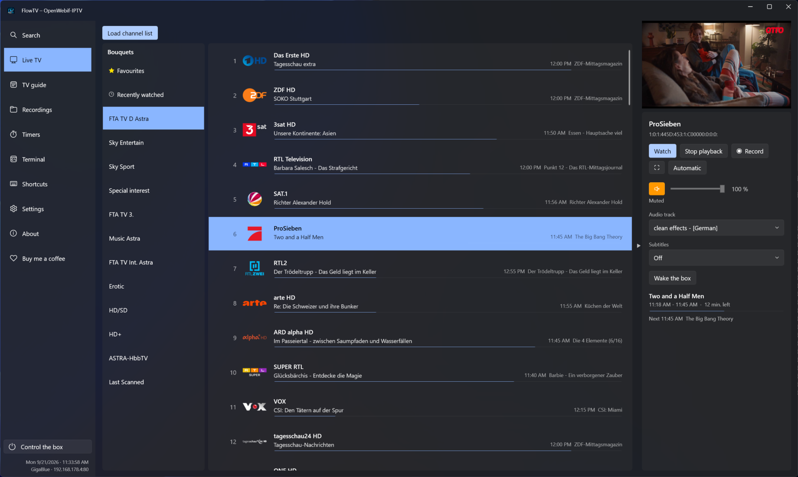
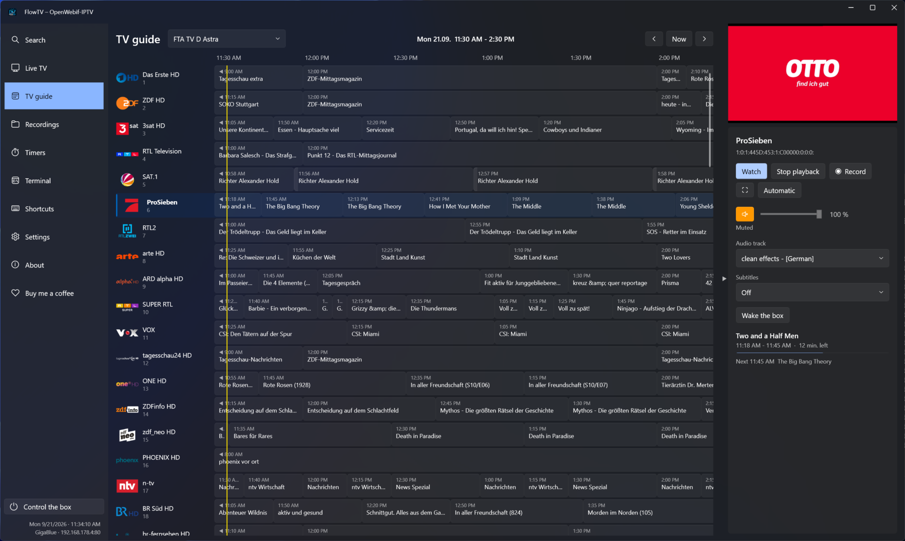
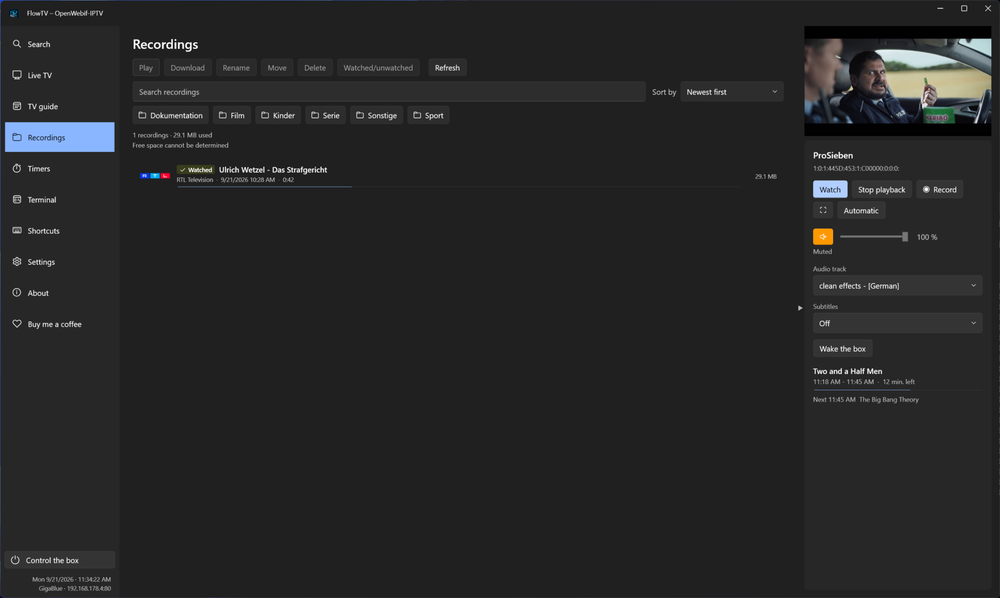
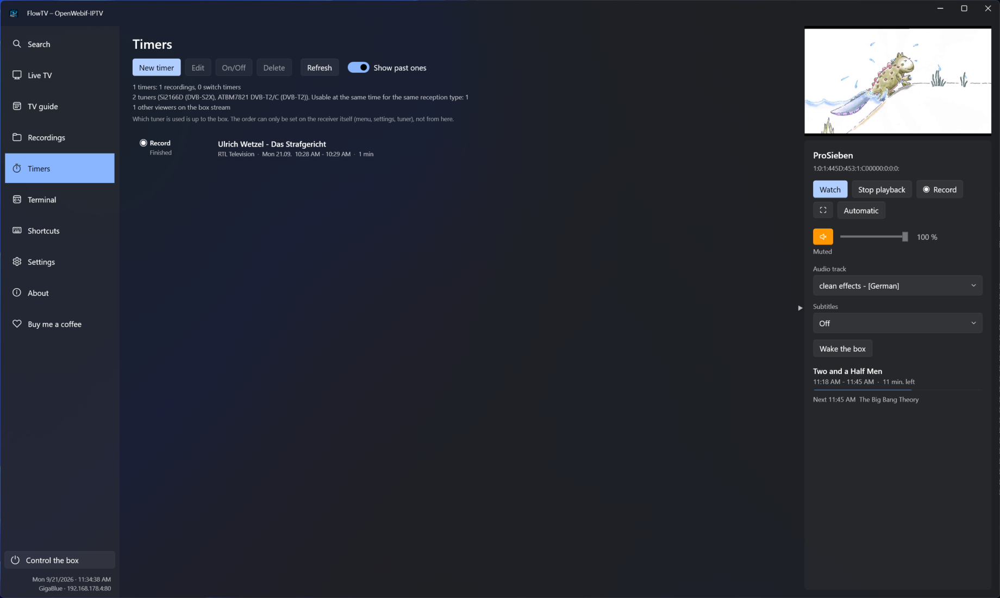
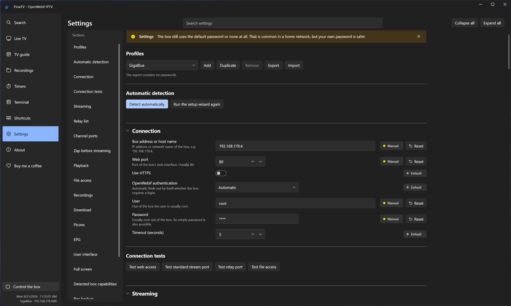
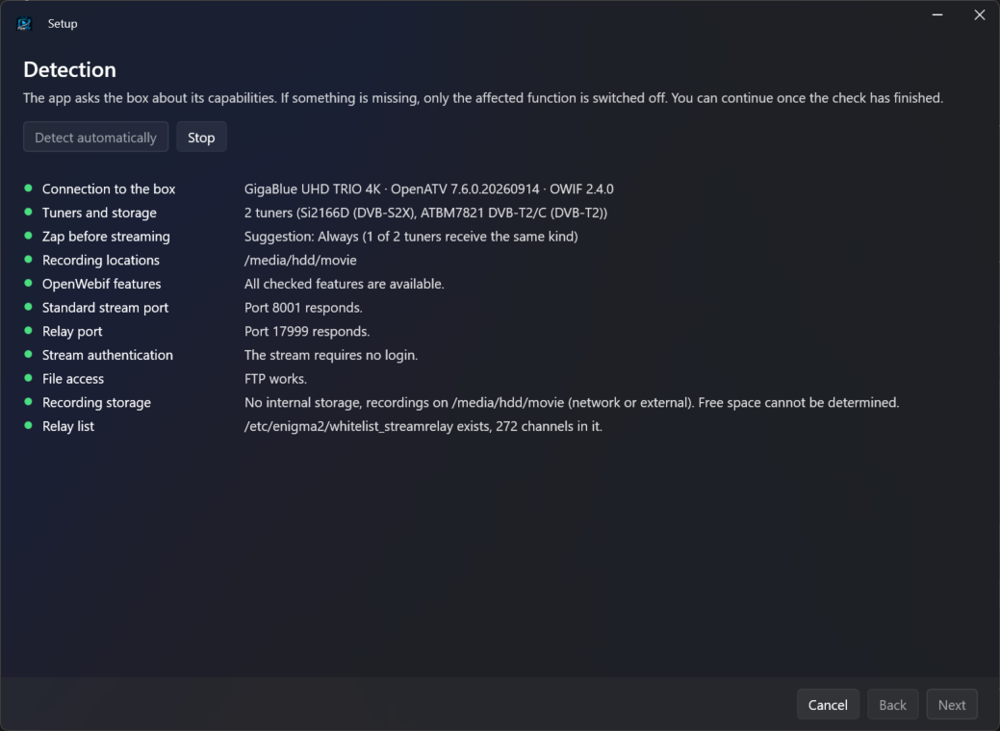
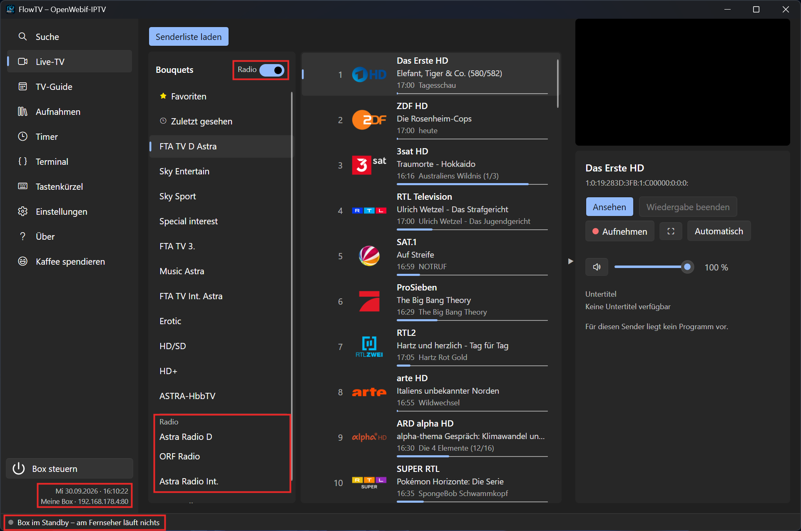
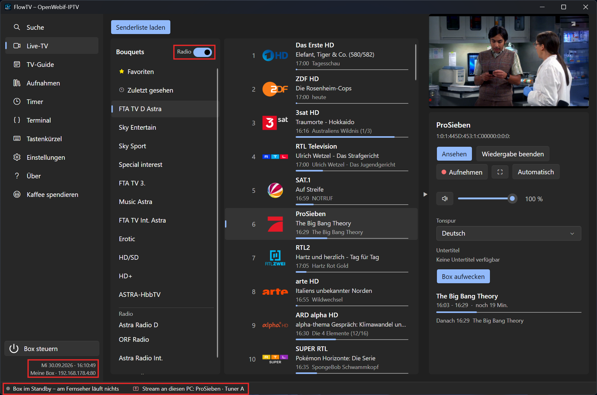
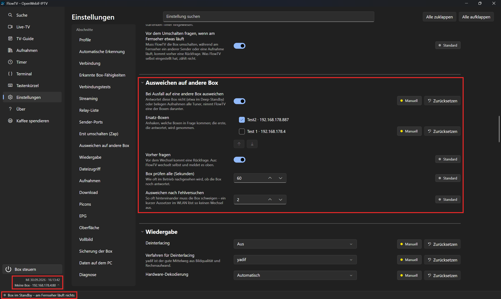
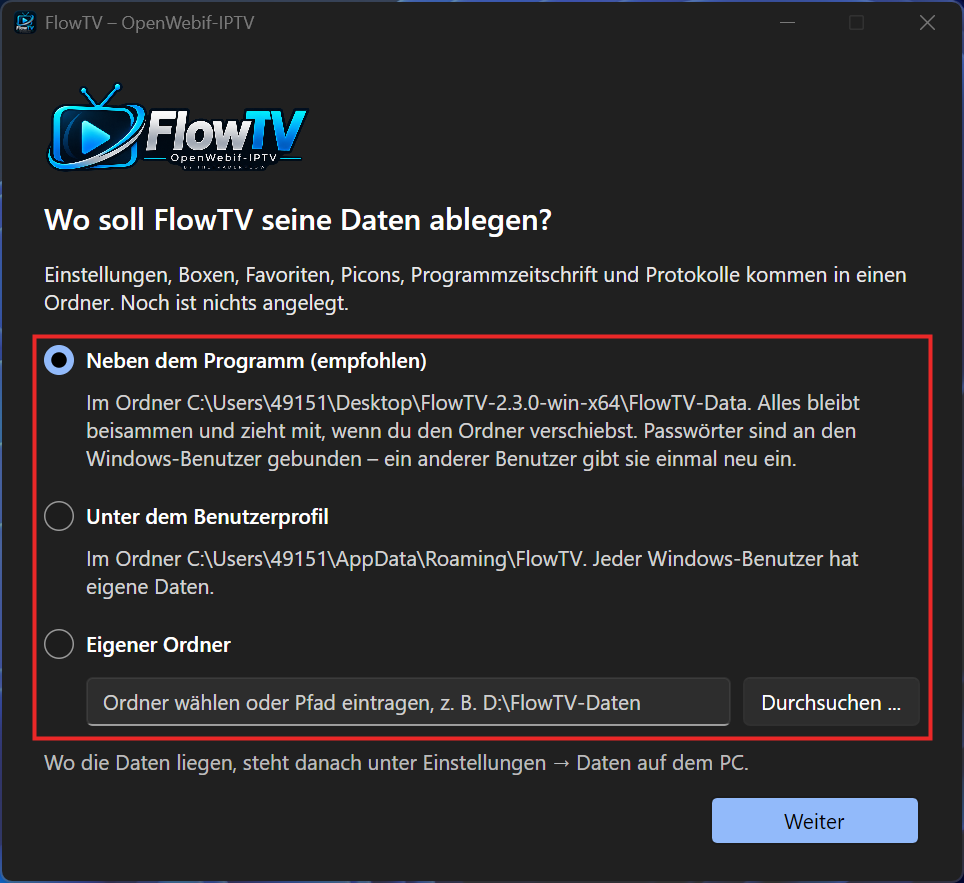

<div align="center">


**Client for Enigma2 receivers over OpenWebif – Windows, plus Linux and Mac as previews**

[Deutsch](#deutsch) · [English](#english) · [Download](../../releases/latest)

</div>

---

## English

FlowTV turns a PC into a second TV set for an Enigma2 receiver. It talks
to the box over **OpenWebif**, shows your own channel lists with picons, the
programme guide, live TV, timers and recordings – and it never shows a black
screen while switching channels.



### What it does

- **Channel lists with picons**, straight from your box. Favourites and a
  “recently watched” list live on the PC, so they are there even when the box is
  off.
- **Live TV** through LibVLC, with the standard port and the stream relay port
  for encrypted channels; if one does not answer, the other is used.
- **What's on the box**: a bar at the bottom shows what the TV is showing, which
  recordings are running and who gets streams – and FlowTV asks before it would
  switch the box away from something somebody is watching.
- **Several boxes**: switch between them at the bottom left, and if one does not
  answer, FlowTV can offer another one.
- **Radio**: radio bouquets below the TV bouquets, one switch away.
- **Programme guide** with a grid, a detail card and a search over all channels.
- **Timers**: record or just switch over at the start of a programme, with tuner
  conflict detection – it will not start something that would break a running
  recording.
- **Recordings**: watch with resume, download over FTP/SFTP/HTTP with a queue,
  rename, move, delete.
- **Box control**: standby, restart, shutdown, a terminal with prepared commands
  (select and copy across lines), a **settings backup like the openATV menu**
  and fetching full backups of the box.
- **Dark, TiviMate-like interface**, German and English, adjustable font size and
  freely assignable keys.

### Why 2.0 – and why it was rebuilt

FlowTV 1.0 was built on WPF, Microsoft's interface technology that only exists
on Windows. For 2.0 the whole interface was **rebuilt on Avalonia**, which runs
on Windows, Linux and macOS from one and the same code. What stays the same:
the functions, the look, your settings. What changes: the same FlowTV can now
also run on **Linux** (from 2.0) and the **Mac** (from 2.5), both as previews –
without three separate programs that would drift apart.

On the way, many things from everyday use got better – see the
[changelog](CHANGELOG.md).

### A look inside

|  |  |
|---|---|
|  |  |
| **Programme guide** – grid, “now” jump, the running programme marked | **Recordings** – watch with resume, download, rename, move |
|  |  |
| **Timers** – recording and switch timers, with what the tuners allow | **Settings** – everything adjustable, and every value says where it came from |

The setup wizard on the very first start searches the network, asks for the
login and then asks the box what it can do:



*The pictures show the English interface; the app speaks German as well.*

### New in 2.2 and 2.3

The red frames mark what is new. These pictures show the German interface.

|  |  |
|---|---|
|  |  |
| **Radio switch** above the bouquets, radio bouquets below the TV ones; **box selection** at the bottom left; the **status bar** shows that the box is in standby | The status bar also shows **which tuner** delivers the stream to this PC |
|  |  |
| **Failover**: if the box does not answer, FlowTV can switch to another one – you choose which boxes and whether it asks first | **First start**: FlowTV asks where to keep its data – next to the program (portable), in the user profile or in a folder of your choice |

### New in 2.4

- **Settings backup like the openATV menu.** Preselected is what openATV backs
  up itself – channel lists, timers, settings, cam configuration, network, skin
  customisations, package feeds. In a box browser you tick further folders and
  files at any depth, or leave some out. The backup is saved in the receiver's
  own format (`backup_<image>_<box>/enigma2settingsbackup.tar.gz`, with the
  list of your plugins): copy the folder to a USB stick and the box finds it
  under *Restore settings*. User files and programs are never included.
- **No more freezing when switching channels** – stopping the old channel now
  runs in the background.
- **Setup and terminal:** “Next” only once a box is chosen; “No file access”
  says why; the terminal selects and copies across lines.

The full list is in the [changelog](CHANGELOG.md).

### Download and start

1. Get the latest `FlowTV-<version>-win-x64.zip` from the
   [Releases page](../../releases/latest). *(32-bit Windows: take
   `FlowTV-<version>-win-x86.zip` instead – a preview, see below. Linux: see
   [below](#linux-preview); Mac: [below](#mac-preview).)*
2. Unpack it to any folder – for example `C:\Programme\FlowTV`. **Do not run it
   from inside the ZIP.**
3. Start `FlowTV.exe`.

**Windows will warn you on the first start** (“Windows protected your PC”). The
program is not code-signed – a certificate costs money that this project does not
have. Click **More info** and then **Run anyway**. If you would rather not, that
is a legitimate decision; the warning says nothing about what the program does.

**Windows Firewall** will ask for network access on the first start. FlowTV needs
it for **private networks** – that is where your receiver is.

**The first start can take a little longer.** That is Windows, not FlowTV:
playback is done by LibVLC, which brings around 270 plugin files, and Windows
Defender looks at every one of them once. Measured: a few seconds up to half a
minute for files it does not know yet, depending on the PC, and **0.3 seconds**
once it does. The window itself is there immediately and can be used; only the
picture waits.

If it bothers you, adding the FlowTV folder to the Defender exclusions makes it
quick every time – that is your decision, and the program works fine without
it.

Since 2.1, Windows only takes this long on the very first start after
unpacking: FlowTV then writes an index of the plugins, and later starts – even
right after booting the PC – are quick. Since 2.1.1 a small “FlowTV is starting …”
window shows up during that first start, and starting FlowTV a second time
just brings the open window to the front – it only ever runs once.

**Updating:** unpack the new ZIP into a new folder and start `FlowTV.exe`.
Settings, profiles, favourites and key bindings live in `%AppData%\FlowTV` and
carry over. Delete the old folder afterwards.

**If your data is next to the program** (a folder `FlowTV-Data` or a file
`FlowTV-Data.txt` beside `FlowTV.exe`, see *First start*): copy that folder or
file into the new folder before the first start – or unpack the new version
over the old one.

### New versions

FlowTV checks GitHub **at every start** and, while it is running, **at 8 am,
12 pm and 6 pm** whether there is a newer version **for your system** (since 2.2;
2.1 checked once a day). If there is, the **About** menu entry gets a
coloured dot, and the About page has a button to the release page. There is no
pop-up and nothing is downloaded automatically – you download and unpack it
yourself. GitHub sees your IP address when FlowTV asks; nothing else is sent.
You can switch it off under *Settings → User interface → Check for new versions*.

**Not every release has packages for every system.** If only Windows
changed, a release contains only the Windows ZIP – Linux users have
nothing to do and FlowTV does not bother them. The latest package for your
system is then on an earlier release. Version 2.0.0 cannot check yet; from 2.0
please update to 2.1 by hand once.

### Linux (preview)

Since 2.0 there is a Linux version: `FlowTV-<version>-linux-x64.tar.gz` on the
[Releases page](../../releases/latest). It needs a 64-bit PC (x64) with a normal
desktop (X11, or Wayland with XWayland – the default on current distributions).

**1. Install VLC.** On Linux, FlowTV uses the VLC of your system instead of
bringing its own – that way your distribution keeps it up to date.

| Distribution | Command |
|---|---|
| Ubuntu, Debian, Linux Mint | `sudo apt install vlc` |
| Fedora | enable [RPM Fusion](https://rpmfusion.org/Configuration), then `sudo dnf install vlc` |
| Arch, Manjaro | `sudo pacman -S vlc vlc-plugins-all` |
| openSUSE | `sudo zypper install vlc` (all codecs via [Packman](https://en.opensuse.org/Additional_package_repositories#Packman)) |

Without VLC, FlowTV starts anyway and tells you exactly this, with the command.

**2. Optional: keyring for passwords.** FlowTV encrypts the passwords for your
box. The key goes to the desktop's keyring (GNOME Keyring, KWallet) via
`secret-tool`; on Ubuntu/Debian that is `sudo apt install libsecret-tools`.
Without it, the key is kept in a file only you can read – that works too.

**3. Unpack and start** – in a terminal, in the folder with the download:

```
tar xzf FlowTV-<version>-linux-x64.tar.gz
cd FlowTV-<version>-linux-x64
./FlowTV
```

**4. Optional: a launcher in the menu.** Save this as
`~/.local/share/applications/flowtv.desktop` and adjust the path to where you
unpacked FlowTV:

```
[Desktop Entry]
Type=Application
Name=FlowTV
Comment=Enigma2 receiver over OpenWebif
Exec=/home/YOUR-NAME/FlowTV-<version>-linux-x64/FlowTV
Icon=/home/YOUR-NAME/FlowTV-<version>-linux-x64/flowtv.png
Categories=AudioVideo;Video;TV;
```

Settings live in `~/.config/FlowTV`, or in `FlowTV-Data` next to the program if
you chose that on the first start. **Updating:** unpack the new version and
start it – the settings stay where they are; with `FlowTV-Data` next to the
program, take that folder along.

**Honestly: it is a preview.** It was tested on **Ubuntu 24.04 in WSL2** (the
Linux inside Windows) against the same box: setup, channel list, picture,
switching, guide – all fine. **Sound under WSL stutters** – plain VLC does the
same there, it is WSL's sound bridge, not FlowTV. On a real Linux PC it has not
been tested yet, nor on the other distributions in the table. Reports are very
welcome.

### Mac (preview)

There is a Mac version again: `FlowTV-<version>-osx-x64.tar.gz` on the
[Releases page](../../releases/latest). The package contains an illustrated
guide, **`FlowTV-Mac-Anleitung.pdf`** (German), with a picture of every step.

**Honestly: it is a preview.** It was tested in a **macOS 15 virtual machine**
against a receiver: setup, channel list, picture, switching, menus. In that
virtual machine the sound output hangs – plain VLC does the same there. FlowTV
detects this and keeps playing without sound (with a notice); under Settings →
Playback → Audio output you can switch sound off for good. On a real Mac sound
should work, but we could not check that ourselves. Reports are very welcome.

**What you need**

- macOS 13 (Ventura) or later.
- Intel or Apple silicon (M1–M4): it is an **Intel build**, because LibVLC for the
  Mac only exists for Intel as a package. On Apple silicon it runs through
  **Rosetta 2** – if that is missing, macOS offers to install it on the first
  start (click “Install”), or in Terminal:
  `softwareupdate --install-rosetta --agree-to-license`
- Nothing else: VLC and .NET are inside the app.

**Updating from an older version:** drag the old `FlowTV` from **Applications**
to the **Trash**, then continue with step 1. Your settings stay. macOS asks for
the approval (steps 3–5) once more for every new version.

**Install and start – step by step**

FlowTV is not notarized by Apple (that costs money this project does not have).
That is why macOS asks once on the first start. You do **not** need Terminal for
this.

1. **Unpack.** Double-click `FlowTV-<version>-osx-x64.tar.gz` in Finder. You get
   a folder with **FlowTV** (the app) and the PDF guide.
2. **Move to Applications.** Drag **FlowTV** into **Applications** (left side of
   the Finder window).
3. **First start.** Double-click **FlowTV** in Applications. macOS says FlowTV
   was not opened because Apple could not check it, with the buttons **Done**
   and **Move to Trash**. Click **Done** – **not** “Move to Trash”.
4. **Allow it in System Settings.** Apple menu → **System Settings → Privacy &
   Security**, scroll all the way down to **Security**. There it says
   *“FlowTV” was blocked to protect your Mac.* Click **Open Anyway** next to it
   and confirm with your **Mac password** (or Touch ID).
5. **Confirm once more.** A window *Open “FlowTV”?* appears. Click the grey
   **Open Anyway** in the middle – careful: the **blue** button at the top is
   “Move to Trash”. FlowTV now starts; from now on a double-click is enough.
6. **Allow the local network.** As soon as FlowTV searches for your receiver
   (setup assistant → “Find the box”), macOS asks: *Allow “FlowTV” to find
   devices on local networks?* Click **Allow** – without it FlowTV cannot reach
   your receiver. If FlowTV already shows “No route to host” behind the
   question, that is normal: just click “Find the box” again after allowing.
7. **Set up the box.** The assistant finds your receiver; otherwise enter its IP
   address by hand. Load the channel list, pick a channel – done.
8. **Allow the keychain.** When FlowTV saves a password of your box for the first
   time, macOS asks whether FlowTV may use the **keychain**. Enter your Mac
   password and click **Always Allow**. Only the key for your box password is
   kept there – FlowTV never stores it in plain text.

**If something went wrong**

- *“FlowTV is damaged and can’t be opened”* is the same block in other words.
  Open **Terminal** (Applications → Utilities), enter
  `xattr -dr com.apple.quarantine /Applications/FlowTV.app` and start FlowTV
  normally.
- Clicked **“Don’t Allow”** for the local network by mistake? **System Settings →
  Privacy & Security → Local Network**, switch **FlowTV** on, restart FlowTV.
- Settings live in `~/Library/Application Support/FlowTV` (in Finder: Go → Go to
  Folder, Cmd+Shift+G).

**Please report back** in an [issue](../../issues): your Mac model, chip and
macOS version, what worked and what did not, and the **diagnostics export**
(Settings → Diagnostics → Export diagnostics). It contains no passwords.

### What you need

**On the PC – nothing to install beforehand:**

- 64-bit Windows 10 or 11.
- *32-bit Windows 10: since 2.6.0 there is a separate package `win-x86`, as a
  preview. It could only be checked on a 64-bit PC. A 32-bit program can use at
  most 2–4 GB of memory, so HD and especially 4K/HEVC channels may stutter on
  older PCs. Not sure which Windows you have? Settings → System → About →
  “System type”.*
- No .NET: the runtime is inside the folder.
- No VLC: LibVLC ships as its own DLLs in the `libvlc` subfolder.
- No Visual C++ redistributable.
- *Linux: 64-bit (x64) and VLC from the package manager – see above.*

**On the receiver:**

- **OpenWebif must be running** and reachable – without it, nothing works.
- **SSH** (Dropbear or OpenSSH) for the terminal and the settings backup
  (`tar` on the box; every Enigma2 image has it).
- **FTP or SFTP** for downloading recordings.
- For encrypted channels over a stream relay: the relay service and its list at
  `/etc/enigma2/whitelist_streamrelay`.

Whatever is missing simply stays greyed out and says why – the rest keeps
working.

### First start

On the very first start (Windows and Linux, since 2.3) FlowTV asks where to keep
its data: **next to the program** in a folder `FlowTV-Data` (recommended –
everything stays together), **in the user profile** or in **a folder of your
own**. If FlowTV may not write to its own folder (e.g. under “Program Files”),
only the user profile is offered. Where the data lives is shown later under
Settings → Data on this PC. Passwords are tied to the Windows user: another user
or PC enters them once more.

A short wizard then searches the local network for boxes, asks for the login and
detects what your box can do. Everything it finds can be overridden by hand, and
every value shows where it came from: default, detected or set by you.

### Tested on one box only – please read this

This project has one developer and one receiver. **Everything you see was tested
on a GigaBlue UHD TRIO 4K** – up to 2.3 with openATV 7.6 and OpenWebif 2.4,
**since 2.4 with openATV 8.0.1.**

- **Receivers with several tuners could not be tested.** The most delicate part
  sits exactly there: counting tuners per reception type, comparing
  transponders, and protecting a running recording. That logic is covered by
  automated tests and written defensively, but nobody has watched it run on real
  hardware with more than one tuner. Since 2.2 FlowTV also asks the box which
  tuners are busy with the TV picture, recordings and streams, and counts per
  reception type – reports from boxes with several tuners are especially welcome.
- **Other images** (VTi, OpenPLi, PurE2 …) are untested. The app parses
  defensively and greys out what a box cannot do – that is what it is built for,
  but it is not proven.

**Bug reports are very welcome, especially from other boxes.** Please open an
[issue](../../issues) and attach the **diagnostics export** (Settings →
Diagnostics): it anonymises credentials and contains exactly the answers of your
box that are needed to understand the problem.

And the honest part: a bug that only happens on a box that is not standing here
may not be reproducible, and then it cannot be fixed with certainty. Please
report it anyway – several reports about the same box make a pattern.

### Support the project

FlowTV is made in spare time and is free for you. If you would like to support
it, there is a **coffee fund**:

- [Ko-fi](https://ko-fi.com/the_flow)
- [Revolut](https://revolut.me/the_flow)

Crypto addresses (BTC, ETH, SOL, XRP) are inside the app under **Buy me a
coffee**, with copy buttons and QR codes – so there is only one place where they
are kept, and it cannot go out of sync.

Feedback is worth just as much as money: bugs and ideas are what the next
version is made of.

### License

The program code is **proprietary** – see [LICENSE.txt](LICENSE.txt). It is not
open source, and this repository contains no source code.

The app ships third-party software; name, version, license and project page of
every component are listed in
[THIRD-PARTY-NOTICES.txt](THIRD-PARTY-NOTICES.txt), the full license texts are in
[licenses](licenses). In particular **LibVLC is used under LGPL-2.1-or-later**:
its files are separate, replaceable libraries in the `libvlc` subfolder next to
the program – neither statically linked nor bundled – and can be exchanged for
another build. Sources: <https://code.videolan.org/videolan/vlc>. On Linux,
FlowTV uses the VLC installed on the system and ships none.

FlowTV ships **no channel lists, picons or programme data**. Everything you see
comes from your own receiver.

### Not affiliated

FlowTV is an independent work. It is **not officially affiliated with the
OpenWebif project, with VideoLAN, or with any receiver manufacturer**, and is
neither endorsed nor reviewed by them. Names and trademarks mentioned belong to
their respective owners and are used only to describe the interface.

---

## Deutsch

FlowTV macht aus einem PC einen zweiten Fernseher für einen
Enigma2-Receiver. Es spricht über **OpenWebif** mit der Box, zeigt deine eigenen
Senderlisten mit Picons, die Programmzeitschrift, Live-TV, Timer und Aufnahmen –
und beim Umschalten gibt es nie ein schwarzes Bild.


### Was es kann

- **Senderlisten mit Picons**, direkt von der Box. Favoriten und „zuletzt
  gesehen" liegen auf dem PC und sind auch da, wenn die Box aus ist.
- **Live-TV** über LibVLC, mit Standardport und Stream-Relay-Port für
  verschlüsselte Sender; antwortet der eine nicht, wird der andere genommen.
- **Was läuft auf der Box**: Eine Leiste unten zeigt, was der Fernseher gerade
  zeigt, welche Aufnahmen laufen und wer Streams bekommt – und FlowTV fragt, bevor
  es die Box von etwas wegschalten würde, das gerade jemand ansieht.
- **Mehrere Boxen**: unten links zwischen ihnen wechseln, und antwortet eine
  nicht, kann FlowTV eine andere anbieten.
- **Radio**: Radio-Bouquets unter den TV-Bouquets, ein Schalter genügt.
- **TV-Guide** mit Raster, Detailkarte und Suche über alle Sender.
- **Timer**: aufnehmen oder zur Sendezeit nur umschalten, mit Erkennung von
  Tuner-Konflikten – es wird nichts gestartet, was eine laufende Aufnahme
  abbrechen würde.
- **Aufnahmen**: ansehen mit Fortsetzen, herunterladen über FTP/SFTP/HTTP mit
  Warteschlange, umbenennen, verschieben, löschen.
- **Box-Steuerung**: Standby, Neustart, Ausschalten, ein Terminal mit
  vorbereiteten Befehlen (Markieren und Kopieren über mehrere Zeilen), eine
  **Einstellungssicherung wie im Menü von openATV** und das Holen von
  Vollsicherungen der Box.
- **Dunkle, TiviMate-ähnliche Oberfläche**, Deutsch und Englisch, einstellbare
  Schriftgröße und frei belegbare Tasten.

### Warum 2.0 – und warum neu gebaut

FlowTV 1.0 war mit WPF gebaut, Microsofts Oberflächentechnik, die es nur unter
Windows gibt. Für 2.0 ist die ganze Oberfläche **auf Avalonia neu gebaut**
worden – das läuft unter Windows, Linux und macOS aus ein und demselben Code.
Was bleibt: die Funktionen, das Aussehen, deine Einstellungen. Was sich ändert:
Dasselbe FlowTV läuft jetzt auch auf **Linux** (ab 2.0) und dem **Mac** (ab 2.5),
beide als Vorschau – ohne drei getrennte Programme, die auseinanderlaufen.

Nebenbei ist vieles aus dem Alltag besser geworden – siehe die
[Änderungen](CHANGELOG.md).

### Ein Blick hinein

|  |  |
|---|---|
|  |  |
| **TV-Guide** – Raster, Sprung auf „jetzt", die laufende Sendung markiert | **Aufnahmen** – ansehen mit Fortsetzen, herunterladen, umbenennen, verschieben |
|  |  |
| **Timer** – Aufnahme- und Umschalt-Timer, mit dem, was die Tuner hergeben | **Einstellungen** – alles einstellbar, und bei jedem Wert steht, woher er kommt |

Der Einrichtungsassistent beim allerersten Start sucht im Netzwerk, fragt nach
der Anmeldung und fragt dann die Box, was sie kann:


*Die Bilder zeigen die englische Oberfläche; die App spricht genauso Deutsch.*

### Neu in 2.2 und 2.3

Die roten Rahmen zeigen, was neu ist.

|  |  |
|---|---|
|  |  |
| **Radio-Schalter** über den Bouquets, Radio-Bouquets unter den TV-Bouquets; **Boxauswahl** unten links; die **Leiste** zeigt, dass die Box im Standby ist | Die Leiste zeigt auch, **welcher Tuner** den Stream an diesen PC liefert |
|  |  |
| **Ausweichen**: Antwortet die Box nicht, kann FlowTV eine andere nehmen – du wählst, welche Boxen, und ob vorher gefragt wird | **Erster Start**: FlowTV fragt, wo die Daten hinkommen – neben das Programm (portabel), ins Benutzerprofil oder in einen eigenen Ordner |

### Neu in 2.4

- **Einstellungssicherung wie im Menü von openATV.** Vorausgewählt ist, was
  openATV selbst sichert – Senderlisten, Timer, Einstellungen,
  Cam-Konfiguration, Netzwerk, Skin-Anpassungen, Paketquellen. In einem
  Box-Browser kreuzt du Ordner und Dateien beliebig tief dazu oder nimmst sie
  heraus. Gespeichert wird im Format der Box
  (`backup_<Image>_<Box>/enigma2settingsbackup.tar.gz`, samt Liste deiner
  Plugins): Ordner auf einen USB-Stick kopieren, und die Box findet die
  Sicherung unter *Einstellungen wiederherstellen*. Benutzerdateien und
  Programme kommen nie hinein.
- **Kein Einfrieren mehr beim Umschalten** – das Anhalten des alten Senders
  läuft jetzt im Hintergrund.
- **Einrichtung und Terminal:** „Weiter“ erst, wenn eine Box gewählt ist; bei
  „Kein Dateizugriff“ steht der Grund dabei; im Terminal lässt sich über
  mehrere Zeilen markieren und kopieren.

Alles Weitere steht in den [Änderungen](CHANGELOG.md).

### Herunterladen und starten

1. Die neueste `FlowTV-<Version>-win-x64.zip` von der
   [Releases-Seite](../../releases/latest) holen. *(32-Bit-Windows: stattdessen
   `FlowTV-<Version>-win-x86.zip` – Vorschau, siehe unten. Linux: siehe
   [unten](#linux-vorschau); Mac: [unten](#mac-vorschau).)*
2. In einen beliebigen Ordner **entpacken** – zum Beispiel
   `C:\Programme\FlowTV`. **Nicht aus der ZIP heraus starten.**
3. `FlowTV.exe` starten.

**Windows warnt beim ersten Start** („Der Computer wurde durch Windows
geschützt"). Das Programm ist nicht signiert – ein Zertifikat kostet Geld, das
dieses Projekt nicht hat. Auf **Weitere Informationen** und dann **Trotzdem
ausführen** klicken. Wer das nicht möchte, hat gute Gründe; die Warnung sagt
nichts darüber aus, was das Programm tut.

**Die Windows-Firewall** fragt beim ersten Start nach Netzwerkzugriff. FlowTV
braucht ihn für **private Netzwerke** – dort steht dein Receiver.

**Der erste Start kann etwas länger dauern.** Das ist Windows und nicht
FlowTV: Die Wiedergabe übernimmt LibVLC, das rund 270 Plugin-Dateien mitbringt,
und der Windows Defender sieht sich jede einmal an. Gemessen: je nach PC ein
paar Sekunden bis eine halbe Minute für Dateien, die er noch nicht kennt, und
**0,3 Sekunden**, sobald er sie kennt. Das Fenster ist sofort da und lässt sich
bedienen; nur das Bild lässt auf sich warten.

Wen es stört, der nimmt den FlowTV-Ordner in die Ausnahmen des Defenders auf –
das ist deine Entscheidung, und ohne funktioniert das Programm genauso.

Seit 2.1 dauert das unter Windows nur noch beim allerersten Start nach dem
Entpacken so lange: FlowTV legt dann ein Verzeichnis der Plugins an, und alle
weiteren Starts – auch direkt nach dem Hochfahren des PCs – gehen schnell. Seit 2.1.1 zeigt dabei ein kleines Fenster
„FlowTV startet …“, dass es läuft, und ein zweiter Start holt nur das offene
Fenster nach vorn – FlowTV läuft immer nur einmal.

**Update:** Die neue ZIP in einen neuen Ordner entpacken und `FlowTV.exe`
starten. Einstellungen, Profile, Favoriten und Tastenbelegung liegen unter
`%AppData%\FlowTV` und werden übernommen. Den alten Ordner danach löschen.

**Liegen deine Daten neben dem Programm** (ein Ordner `FlowTV-Data` oder eine
Datei `FlowTV-Data.txt` neben `FlowTV.exe`, siehe *Der erste Start*): diesen
Ordner bzw. diese Datei vor dem ersten Start in den neuen Ordner kopieren – oder
die neue Version einfach über die alte entpacken.

### Neue Versionen

FlowTV sieht **bei jedem Start** und, solange es läuft, **um 8, 12 und 18 Uhr**
bei GitHub nach, ob es eine neuere Version **für dein System** gibt (seit 2.2;
2.1 fragte einmal am Tag). Wenn ja, bekommt der Menüpunkt **Über** einen
farbigen Punkt, und auf der Seite führt ein Knopf zur Release-Seite. Es gibt kein
Popup, und heruntergeladen wird nichts von selbst – das machst du selbst.
GitHub sieht bei der Nachfrage deine IP-Adresse; sonst wird nichts übertragen.
Abschalten lässt es sich unter *Einstellungen → Oberfläche → Nach neuer Version
suchen*.

**Nicht jedes Release enthält Pakete für jedes System.** Hat sich nur
Windows geändert, liegt im Release nur die Windows-ZIP – Linux muss
nichts tun, und FlowTV meldet dort auch nichts. Das neueste Paket für dein
System liegt dann bei einem früheren Release. Version 2.0.0 kann noch nicht
nachsehen; von 2.0 bitte einmal von Hand auf 2.1 aktualisieren.

### Linux (Vorschau)

Seit 2.0 gibt es eine Linux-Version: `FlowTV-<Version>-linux-x64.tar.gz` auf der
[Releases-Seite](../../releases/latest). Gebraucht wird ein 64-Bit-PC (x64) mit
einem gewöhnlichen Desktop (X11, oder Wayland mit XWayland – bei aktuellen
Distributionen der Normalfall).

**1. VLC installieren.** Unter Linux nutzt FlowTV das VLC deines Systems, statt
ein eigenes mitzubringen – so hält es deine Distribution aktuell.

| Distribution | Befehl |
|---|---|
| Ubuntu, Debian, Linux Mint | `sudo apt install vlc` |
| Fedora | [RPM Fusion](https://rpmfusion.org/Configuration) einschalten, dann `sudo dnf install vlc` |
| Arch, Manjaro | `sudo pacman -S vlc vlc-plugins-all` |
| openSUSE | `sudo zypper install vlc` (alle Codecs über [Packman](https://en.opensuse.org/Additional_package_repositories#Packman)) |

Ohne VLC startet FlowTV trotzdem und sagt genau das, samt Befehl.

**2. Optional: Schlüsselbund für die Passwörter.** FlowTV verschlüsselt die
Passwörter für deine Box. Der Schlüssel kommt in den Schlüsselbund des Desktops
(GNOME-Schlüsselbund, KWallet) über `secret-tool`; unter Ubuntu/Debian ist das
`sudo apt install libsecret-tools`. Ohne liegt der Schlüssel in einer Datei, die
nur du lesen kannst – das geht auch.

**3. Entpacken und starten** – im Terminal, im Ordner mit dem Download:

```
tar xzf FlowTV-<Version>-linux-x64.tar.gz
cd FlowTV-<Version>-linux-x64
./FlowTV
```

**4. Optional: ein Starter im Menü.** Das hier als
`~/.local/share/applications/flowtv.desktop` speichern und den Pfad an den Ort
anpassen, an dem FlowTV entpackt liegt:

```
[Desktop Entry]
Type=Application
Name=FlowTV
Comment=Enigma2-Receiver über OpenWebif
Exec=/home/DEIN-NAME/FlowTV-<Version>-linux-x64/FlowTV
Icon=/home/DEIN-NAME/FlowTV-<Version>-linux-x64/flowtv.png
Categories=AudioVideo;Video;TV;
```

Die Einstellungen liegen unter `~/.config/FlowTV` oder, wenn du das beim ersten
Start gewählt hast, in `FlowTV-Data` neben dem Programm. **Update:** die neue
Version entpacken und starten – die Einstellungen bleiben, wo sie sind; liegt
`FlowTV-Data` neben dem Programm, den Ordner mitnehmen.

**Ehrlich gesagt: eine Vorschau.** Geprüft wurde sie unter **Ubuntu 24.04 in
WSL2** (dem Linux in Windows) an derselben Box: Einrichtung, Senderliste, Bild,
Umschalten, TV-Guide – alles in Ordnung. **Der Ton hakt unter WSL** – das
normale VLC tut dort dasselbe, es liegt an der Tonbrücke von WSL, nicht an
FlowTV. Auf einem echten Linux-PC ist sie noch nicht geprüft, ebenso wenig auf
den übrigen Distributionen der Tabelle. Rückmeldungen sind sehr willkommen.

### Mac (Vorschau)

Es gibt wieder eine Mac-Version: `FlowTV-<Version>-osx-x64.tar.gz` auf der
[Releases-Seite](../../releases/latest). Im Paket liegt eine bebilderte
Anleitung, **`FlowTV-Mac-Anleitung.pdf`**, mit einem Bild zu jedem Schritt.

**Ehrlich gesagt: Es ist eine Vorschau.** Geprüft wurde sie in einer
**virtuellen Maschine mit macOS 15** an einer Box: Einrichtung, Senderliste,
Bild, Umschalten, Menüs. In dieser virtuellen Maschine hängt die Tonausgabe –
das normale VLC tut dort dasselbe. FlowTV erkennt das und spielt ohne Ton weiter
(mit Hinweis); unter Einstellungen → Wiedergabe → Tonausgabe lässt sich der Ton
ganz abschalten. Auf einem echten Mac sollte der Ton gehen, selbst prüfen
konnten wir das nicht. Rückmeldungen sind sehr willkommen.

**Was du brauchst**

- macOS 13 (Ventura) oder neuer.
- Intel oder Apple-Chip (M1–M4): Es ist ein **Intel-Build**, weil es LibVLC für
  den Mac nur für Intel als Paket gibt. Auf Apple-Chip läuft es über
  **Rosetta 2** – fehlt es, bietet macOS die Installation beim ersten Start an
  („Installieren“ klicken), oder im Terminal:
  `softwareupdate --install-rosetta --agree-to-license`
- Sonst nichts: VLC und .NET stecken in der App.

**Update von einer älteren Version:** Die alte `FlowTV` aus **Programme** in den
**Papierkorb** ziehen und mit Schritt 1 weitermachen. Deine Einstellungen
bleiben. Die Freigabe (Schritte 3–5) fragt macOS bei jeder neuen Version noch
einmal ab.

**Installieren und starten – Schritt für Schritt**

FlowTV ist nicht von Apple beglaubigt (das kostet Geld, das dieses Projekt
nicht hat). Deshalb fragt macOS beim ersten Start einmal nach. Ein **Terminal
brauchst du dafür nicht**.

1. **Entpacken.** Im Finder auf `FlowTV-<Version>-osx-x64.tar.gz` doppelklicken.
   Es entsteht ein Ordner mit **FlowTV** (dem Programm) und der PDF-Anleitung.
2. **In „Programme“ ziehen.** **FlowTV** in den Ordner **Programme** ziehen
   (links im Finder-Fenster).
3. **Erster Start.** In Programme auf **FlowTV** doppelklicken. macOS meldet,
   dass FlowTV nicht geöffnet wurde, weil Apple es nicht überprüfen konnte –
   mit den Knöpfen **„Fertig“** und **„In den Papierkorb legen“**. Auf
   **„Fertig“** klicken, **nicht** auf „In den Papierkorb legen“.
4. **In den Systemeinstellungen freigeben.** Apple-Menü → **Systemeinstellungen
   → Datenschutz & Sicherheit**, ganz nach unten zum Abschnitt **Sicherheit**
   scrollen. Dort steht *„FlowTV“ wurde blockiert, um deinen Mac zu schützen.*
   Daneben auf **„Dennoch öffnen“** klicken und mit dem **Mac-Passwort** (oder
   Touch ID) bestätigen.
5. **Rückfrage bestätigen.** Es erscheint *„FlowTV“ öffnen?*. Den grauen Knopf
   **„Dennoch öffnen“** in der Mitte nehmen – Achtung: Der **blaue** Knopf oben
   ist „In den Papierkorb legen“. FlowTV startet jetzt; ab dann reicht ein
   Doppelklick.
6. **Zugriff aufs Heimnetz erlauben.** Sobald FlowTV deine Box sucht
   (Einrichtungsassistent → „Box suchen“), fragt macOS: *Darf „FlowTV“ nach
   Geräten in lokalen Netzwerken suchen?* Auf **„Erlauben“** klicken – ohne das
   erreicht FlowTV deine Box nicht. Steht hinter der Frage schon „No route to
   host“, ist das normal: Nach „Erlauben“ einfach noch einmal „Box suchen“.
7. **Box einrichten.** Der Assistent findet deine Box; sonst ihre IP-Adresse von
   Hand eintragen. Senderliste laden, Sender wählen, fertig.
8. **Schlüsselbund erlauben.** Speichert FlowTV zum ersten Mal ein Passwort
   deiner Box, fragt macOS, ob FlowTV den **Schlüsselbund** benutzen darf.
   Mac-Passwort eingeben und **„Immer erlauben“** klicken. Dort liegt nur der
   Schlüssel für das Passwort deiner Box – im Klartext speichert FlowTV es nie.

**Wenn etwas schiefging**

- *„FlowTV ist beschädigt und kann nicht geöffnet werden“* ist dieselbe Sperre
  in anderen Worten. **Terminal** öffnen (Programme → Dienstprogramme),
  `xattr -dr com.apple.quarantine /Applications/FlowTV.app` eingeben und FlowTV
  normal starten.
- Beim lokalen Netzwerk aus Versehen **„Nicht erlauben“** gewählt?
  **Systemeinstellungen → Datenschutz & Sicherheit → Lokales Netzwerk**, den
  Schalter bei **FlowTV** einschalten, FlowTV neu starten.
- Die Einstellungen liegen in `~/Library/Application Support/FlowTV` (im Finder:
  Gehe zu → Gehe zum Ordner, Cmd+Umschalt+G).

**Bitte Rückmeldung geben** in einem [Issue](../../issues): Mac-Modell, Chip und
macOS-Version, was ging und was nicht, und den **Diagnose-Export**
(Einstellungen → Diagnose → Diagnosedaten exportieren). Er enthält keine Passwörter.

### Was du brauchst

**Auf dem PC – nichts vorinstallieren:**

- 64-Bit-Windows 10 oder 11.
- *32-Bit-Windows 10: Seit 2.6.0 gibt es ein eigenes Paket `win-x86`, als
  Vorschau. Geprüft werden konnte es nur auf einem 64-Bit-PC. Ein
  32-Bit-Programm kann höchstens 2–4 GB Speicher nutzen; HD- und vor allem
  4K/HEVC-Sender können auf älteren Rechnern ruckeln. Welches Windows du hast:
  Einstellungen → System → Info → „Systemtyp“.*
- Kein .NET: Die Laufzeit liegt im Ordner.
- Kein VLC: LibVLC liegt als eigene DLL-Sammlung im Unterordner `libvlc`.
- Kein Visual C++ Redistributable.
- *Linux: 64 Bit (x64) und VLC aus der Paketverwaltung – siehe oben.*

**Auf der Box:**

- **OpenWebif muss laufen** und erreichbar sein – ohne das geht gar nichts.
- **SSH** (Dropbear oder OpenSSH) für das Terminal und die Einstellungssicherung
  (`tar` auf der Box; hat jedes Enigma2-Image).
- **FTP oder SFTP** zum Herunterladen von Aufnahmen.
- Für verschlüsselte Sender über ein Stream-Relay: der Relay-Dienst und seine
  Liste unter `/etc/enigma2/whitelist_streamrelay`.

Was fehlt, bleibt ausgegraut und erklärt sich – der Rest läuft weiter.

### Der erste Start

Beim allerersten Start (Windows und Linux, seit 2.3) fragt FlowTV, wo es seine
Daten ablegen soll: **neben dem Programm** im Ordner `FlowTV-Data` (empfohlen –
alles bleibt beisammen), **unter dem Benutzerprofil** oder in einem **eigenen
Ordner**. Darf FlowTV nicht in seinen eigenen Ordner schreiben (etwa unter
„Programme“), steht nur das Benutzerprofil zur Wahl. Wo die Daten liegen, steht
später unter Einstellungen → Daten auf dem PC. Passwörter sind an den
Windows-Benutzer gebunden: Ein anderer Benutzer oder PC gibt sie einmal neu ein.

Danach sucht ein kurzer Assistent im Netzwerk nach Boxen, fragt nach der
Anmeldung und erkennt, was deine Box kann. Alles Erkannte lässt sich von Hand
überschreiben, und bei jedem Wert steht, woher er kommt: Standard, erkannt oder
selbst gesetzt.

### Geprüft nur an einer Box – bitte lesen

Hinter diesem Projekt stehen ein Entwickler und ein Receiver. **Alles, was du
hier siehst, ist an einer GigaBlue UHD TRIO 4K geprüft worden** – bis 2.3 mit
openATV 7.6 und OpenWebif 2.4, **seit 2.4 mit openATV 8.0.1.**

- **Receiver mit mehreren Tunern konnten nicht geprüft werden.** Genau dort
  sitzt der empfindlichste Teil: die Tunerzählung nach Empfangsart, der
  Transpondervergleich und der Schutz einer laufenden Aufnahme. Diese Logik ist
  mit automatischen Tests abgedeckt und defensiv gebaut, aber an echter Hardware
  mit mehreren Tunern hat sie niemand laufen sehen. Seit 2.2 fragt FlowTV die Box
  zusätzlich, welche Tuner Fernsehbild, Aufnahmen und Streams gerade belegen, und
  zählt je Empfangsart – Rückmeldungen von Boxen mit mehreren Tunern sind
  besonders willkommen.
- **Andere Images** (VTi, OpenPLi, PurE2 …) sind ungeprüft. Die App parst
  defensiv und graut aus, was eine Box nicht kann – dafür ist sie gebaut,
  bewiesen ist es nicht.

**Fehlermeldungen sind ausdrücklich willkommen, gerade von anderen Boxen.**
Bitte ein [Issue](../../issues) aufmachen und den **Diagnose-Export** anhängen
(Einstellungen → Diagnose): Er anonymisiert Zugangsdaten und enthält genau die
Antworten deiner Box, die zum Verstehen nötig sind.

Und der ehrliche Teil: Ein Fehler, der nur an einer Box auftritt, die hier nicht
steht, lässt sich womöglich nicht nachstellen und damit nicht sicher beheben.
Melde ihn trotzdem – aus mehreren Meldungen zur selben Box wird ein Muster.

### Das Projekt unterstützen

FlowTV entsteht in der Freizeit und ist für dich kostenlos. Wer es unterstützen
möchte, findet hier die **Kaffeekasse**:

- [Ko-fi](https://ko-fi.com/the_flow)
- [Revolut](https://revolut.me/the_flow)

Die Krypto-Adressen (BTC, ETH, SOL, XRP) stehen **in der App** unter **Kaffee
spendieren**, mit Kopierknöpfen und QR-Codes – so gibt es für sie nur eine
Stelle, und die kann nicht auseinanderlaufen.

Eine Rückmeldung ist genauso viel wert wie Geld: Fehler und Ideen sind das,
woraus die nächste Version entsteht.

### Lizenz

Der Programmcode ist **proprietär** – siehe [LICENSE.txt](LICENSE.txt). Er steht
nicht unter einer Open-Source-Lizenz, und dieses Repository enthält keinen
Quelltext.

Die App liefert Software Dritter mit; Name, Version, Lizenz und Projektseite
jedes Bestandteils stehen in
[THIRD-PARTY-NOTICES.txt](THIRD-PARTY-NOTICES.txt), die vollständigen
Lizenztexte im Ordner [licenses](licenses). Insbesondere wird **LibVLC unter der
LGPL-2.1-or-later** verwendet: Die Dateien liegen als eigene, austauschbare
Bibliotheken im Unterordner `libvlc` neben dem Programm – weder statisch
eingebunden noch zusammengepackt – und lassen sich gegen eine andere Version
tauschen. Quelltexte: <https://code.videolan.org/videolan/vlc>. Unter Linux nutzt
FlowTV das auf dem System installierte VLC und liefert keines mit.

FlowTV liefert **keine Senderlisten, Picons oder Programmdaten** mit. Alles, was
zu sehen ist, kommt vom Receiver des Nutzers.

### Keine Verbindung zu Dritten

FlowTV ist ein eigenständiges Werk. Es ist **nicht offiziell verbunden mit dem
OpenWebif-Projekt, mit VideoLAN oder mit Herstellern von Receivern** und wird
von diesen weder unterstützt noch geprüft. Genannte Namen und Marken gehören
ihren jeweiligen Inhabern und werden nur zur Beschreibung der Schnittstelle
verwendet.
